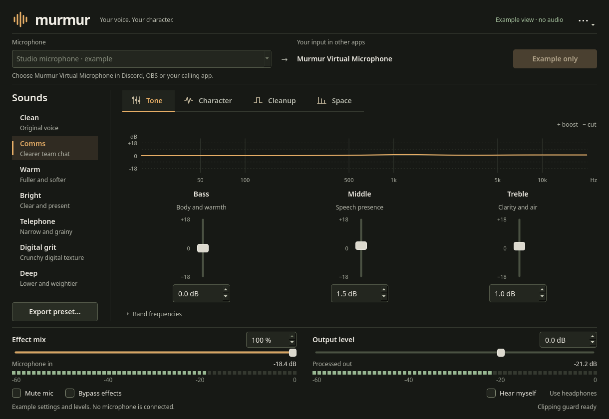

# Murmur

Murmur lets you change how your microphone sounds in games, Discord, OBS, and other apps. It runs on Windows and Linux.

**[Download Murmur for Windows](https://github.com/deltadasher/murmur/releases/download/windows-preview-0.3.0/murmur-windows-experimental.zip)** · [Install guide](INSTALL.md)

Extract the ZIP and open `murmur.exe`. Keep the other files in the same folder.

Pick your microphone, press **Start microphone**, and choose a preset. You can adjust tone, pitch, noise gate, compression, echo, and more. Close the window and the audio keeps running in the background. To stop it, press **Stop microphone** or use **Stop background service** in the menu.

## Download and install

- **Windows:** [Download the Windows preview](https://github.com/deltadasher/murmur/releases/tag/windows-preview-0.3.0). You'll also need [VB-CABLE](https://vb-audio.com/Cable/).
- **Linux:** Build from source with Qt 6 and PipeWire.

See the [install guide](INSTALL.md) for setup steps on both systems.

## Build from source

You'll need CMake, a C++20 compiler, and Qt 6.7 or newer. Linux also needs PipeWire; Windows needs Qt Multimedia. See the [install guide](INSTALL.md) for commands.

Murmur is licensed under the [MIT License](LICENSE).
